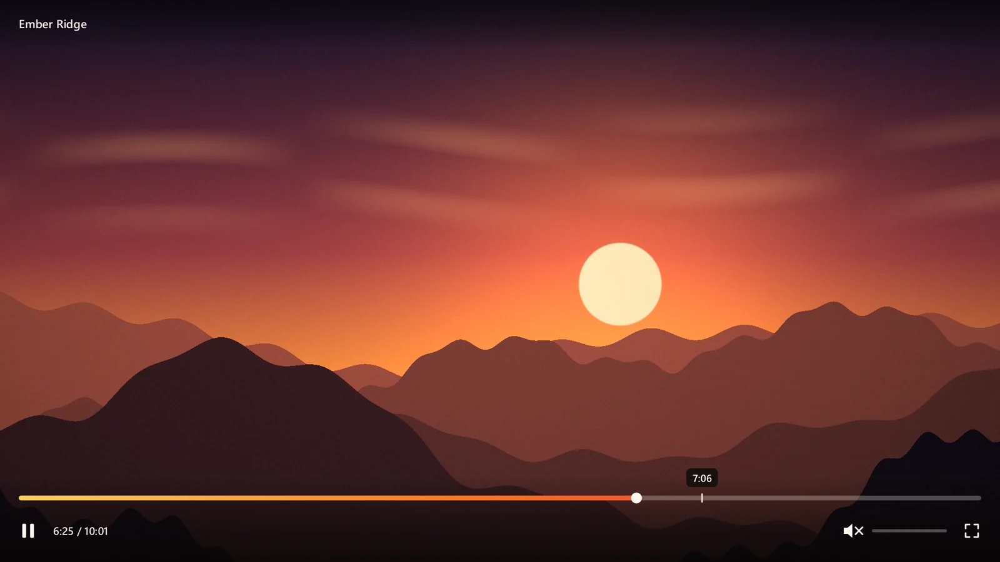
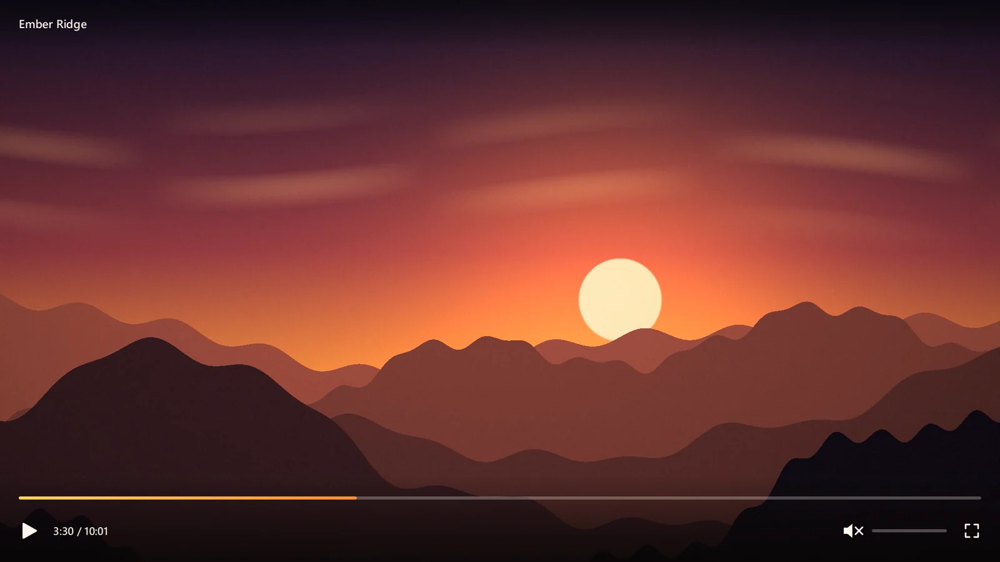
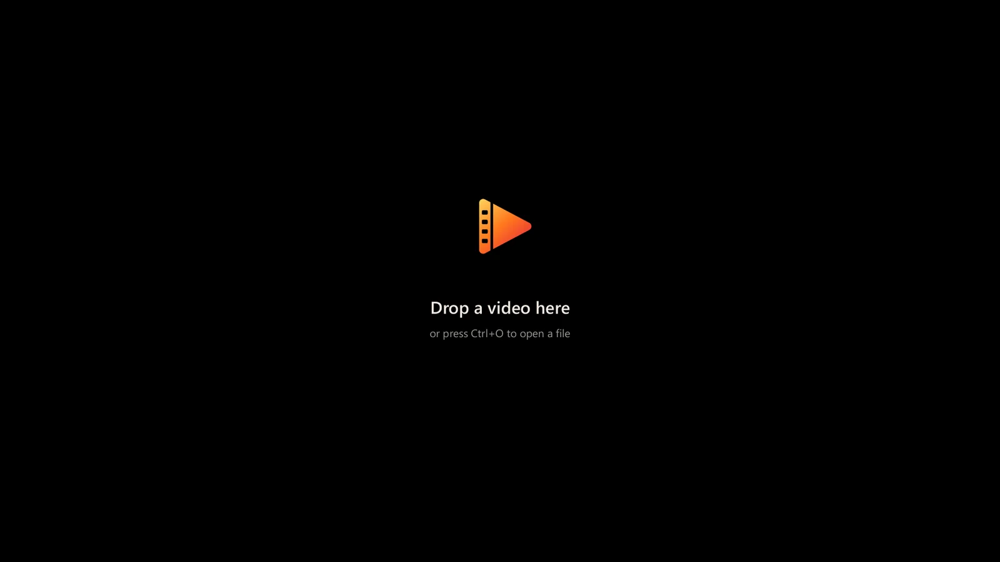

<p align="center">
  <picture>
    <source media="(prefers-color-scheme: dark)" srcset="assets/logo/nitrate-wordmark-light.svg">
    
  </picture>
</p>

<p align="center"><b>A fast, modern media player.</b><br>
Built in Rust on libmpv. Fast locally, and fast over remote desktop.</p>

<p align="center">
  <a href="https://nitrate.renner.dev">Website</a> ·
  <a href="https://github.com/rennerdo30/nitrate/releases">Download</a> ·
  <a href="CHANGELOG.md">Changelog</a>
</p>



> **Status: beta, Windows only.** Nitrate plays files on Windows 10 and 11 with hardware decoding, its own controls, file types and updates. Playlists, track menus and settings are still to come; macOS and Linux build but don't play yet.

## Install

Download the newest release from the [releases page](https://github.com/rennerdo30/nitrate/releases) or the [website](https://nitrate.renner.dev/#download):

- **Setup** (`nitrate-<version>-setup.exe`): installs for your user only, without admin rights. Adds a Start menu entry, puts Nitrate under "Open with" for 21 video and audio types and lists it in Settings > Default apps, where you can make it the default player (the setup's finish page has a shortcut). Installed copies check for updates once a day; when one appears, **Ctrl+Shift+U** installs it.
- **Portable** (`nitrate-<version>-windows-x64.zip`): unpack anywhere and run `nitrate.exe`. Changes nothing on the PC and doesn't update itself.

The setup isn't code-signed yet, so Windows may warn on first run: *More info*, then *Run anyway*. Check downloads against `SHA256SUMS.txt` in the release. Needs a 64-bit CPU with AVX2.

## Use

Open a file from Explorer, drop it on the window, press **Ctrl+O**, or start `nitrate path\to\video.mkv`. The controls appear when you move the mouse and fade while the film plays.

| Paused | Nothing open |
|---|---|
|  |  |

| Keys | |
|---|---|
| Space, K | Play or pause |
| Left, Right | Seek 5 s (Shift: 1 s) |
| J, L | Seek 10 s |
| Up, Down, mouse wheel | Volume |
| M | Mute |
| F, double click | Fullscreen (Esc leaves) |
| `.` and `,` | Step one frame |
| Ctrl+O | Open a file |
| Ctrl+Shift+U | Install an available update |

**Command line:** `nitrate [--mute] [--pause] [--start SECS] [FILE]`; `nitrate --help` lists every option. `NITRATE_NO_UPDATE=1` turns update checks off, `NITRATE_UPDATE_CHANNEL=stable|beta` picks the channel.

## Goals

- **Speed first.** The window appears instantly, seeking answers in the next frame, and a paused player uses no CPU at all.
- **libmpv inside.** Decoding, hardware acceleration, HDR, subtitles and audio come from libmpv, so Nitrate plays what it plays.
- **Native graphics on every platform.** D3D11 on Windows, and the fastest measured path on macOS and Linux, with hardware-decoded frames going straight to the screen.
- **Remote desktop as a first-class target.** In a remote session Nitrate switches to a static, animation-free interface, so the remote connection only carries the video.
- **A modern, quiet interface.** Video first; controls appear when you need them.

The full plan, speed budgets and the rendering decision are in [`docs/SPEC.md`](docs/SPEC.md) and [`docs/decisions/0001-video-and-ui-rendering.md`](docs/decisions/0001-video-and-ui-rendering.md).

## Building

```bat
scripts\run.bat path\to\video.mkv          :: Windows: build, fetch libmpv once, play
scripts\run.bat -Release path\to\video.mkv :: optimized build
scripts\package.bat                        :: setup, zip and checksums in artifacts\installer
```

Nitrate loads libmpv at runtime, so building needs no mpv headers. Details: [`docs/BUILD.md`](docs/BUILD.md). Releases: [`docs/RELEASING.md`](docs/RELEASING.md). The screenshots come from the real player (`scripts/screenshots.ps1`, with Nitrate's own demo footage); the website lives in [`website/`](website/).

## Licence

Nitrate is released under the [MIT licence](LICENSE). Its Rust dependencies are permissively licensed. libmpv and FFmpeg are separate libraries under the LGPL, loaded at runtime and replaceable; the Windows packages ship libmpv with its notice and licence.
