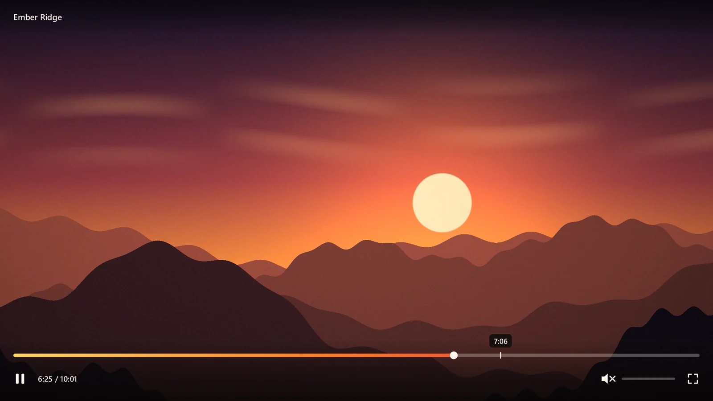

# Nitrate

A fast, modern media player built in Rust on libmpv. Video goes from the hardware decoder straight to the screen, the controls fade while you watch, and it stays fast over remote desktop.



**Status: beta, plays on Windows 10 and 11.** On macOS and Linux it builds, but doesn't play yet.

## Install

The easiest way is the setup or the portable zip from the [releases page](https://github.com/rennerdo30/nitrate/releases) or [nitrate.renner.dev](https://nitrate.renner.dev). Both ship libmpv, and an installed copy updates itself.

With Cargo:

```sh
cargo install nitrate-player --version 0.1.0-beta.1
```

The program is called `nitrate`. Nitrate loads **libmpv at runtime**: put `libmpv-2.dll` next to `nitrate.exe` or on `PATH`. The release zip contains the build Nitrate is tested with. A Cargo-installed copy never updates itself; run `cargo install` again for a new version.

## Use

`nitrate [--mute] [--pause] [--start SECS] [FILE]`. Drop a file on the window or press Ctrl+O. Run `nitrate --help` for every option and key.

More: [README](https://github.com/rennerdo30/nitrate#readme) · [Changelog](https://github.com/rennerdo30/nitrate/blob/main/CHANGELOG.md)

## Licence

MIT. libmpv and FFmpeg are separate LGPL libraries, loaded at runtime and replaceable; they are not part of this crate.
